# BISCORD

A real-time, Discord-style chat web app written entirely in **BSL (Bonezegei Scripting Language)**. A single script, `app.bzg`, serves the web pages, relays live chat over WebSockets, manages user accounts and stores all chat history in a SQLite database. No Node.js is needed to run it.

---

## 1. Project Description

BISCORD lets people on the same network sign up, log in and chat in real time in themed channels from any phone or laptop browser.

### Features

- **Accounts**: sign up and log in with a username (2–16 characters, case-insensitive and unique) and a password.
- **Four channels**: `#general`, `#random`, `#help` and `#memes`.
- **Live messaging**: messages are broadcast to everyone through the WebSocket server (limit: 300 characters per message).
- **Edit and delete your own messages**: hover over one of your messages (or look under it on a phone) to edit it or delete it. Edited messages show an "(edited)" note. Nobody else can edit or delete your messages: the server enforces it (see below).
- **Chat history**: messages are saved in SQLite. The newest 100 messages per channel are loaded after login or a server restart.
- **Picture sharing**: attach or drag-and-drop images (JPEG, PNG, GIF, WebP). They are compressed in the browser, sent in chunks, saved in the database and reloaded when they scroll into view.
- **Typing indicator**: see who is typing in each channel.
- **@mention suggestions**: type `@` in the message box to see everyone with an account (online first, then offline). Keep typing and the list narrows to matching names. Use Up/Down and Enter or Tab (or the mouse) to insert a name, Esc to close.
- **Profile cards**: click your own user card (bottom left) to see and edit your profile, or click any member in the panel to see theirs. A profile has a username, profile picture, backdrop, thought bubble, bio, up to 3 links and a card colour. Only you can change your own (see below).
- **Account settings**: change your username and / or password in a pop-up of its own (lock button next to Log out, or the **Account** button on your own profile card), separate from the profile card where you edit your bio, backdrop and picture. You must type your current password, and before anything is saved a second pop-up shows a summary ("alice -> Alicia", "password: new") and asks you to accept. Everybody sees your new username straight away.
- **Member panel**: shows who is online and how many accounts are registered.
- **Connection console**: a collapsible panel in the chat page that shows the raw packets, handy for debugging.
- **Animated log in / sign up switch**: changing tabs plays a choreographed animation on the whole card: the tab fills with yellow from where you clicked and pops confetti, the mascot jumps and flips, the letters of BISCORD hop in a colour wave, the card lifts off its shadow, the tagline words fly out and in, and the form fields fly out one by one while the card springs to its new height. It can be interrupted at any time, and is skipped when the system has "reduce motion" turned on. The code is in `public/scripts/login.js`, the supporting styles at the end of `public/style.css`.
- **Responsive layout**: works on phones and desktops.

### How it works

The server is one BSL program listening on **port 8000**. The same port handles both plain HTTP (pages and assets) and WebSocket traffic (chat, accounts, history). Everything the clients send is a text packet shaped like:

```
TYPE|id|name|payload
```

| Packet (client → server) | Purpose |
| --- | --- |
| `SIGNUP`, `LOGIN` | Create an account / log in |
| `RESUME` | Chat page asks "is this tab still logged in?" |
| `LOGOUT` | Forget this login |
| `HISTORY` | Request saved messages |
| `USERS` | Request the list of registered accounts |
| `SAVE` | Store a chat message |
| `EDIT` / `DELETE` | Edit or delete a saved message (author only, checked by the server) |
| `IMGH` / `IMGC` / `IMGGET` | Send a picture (header, chunks) / request a saved picture |
| `PROFGET` / `PFGET` | Open someone's profile card / fetch their profile picture or backdrop |
| `PROFF` / `PROFDONE` | Change one of your own profile fields / finish and announce the change (`PROFCHG` goes to everybody) |
| `PFUH` / `PFUC` / `PFUDEL` | Upload (header, pieces) or remove your profile picture or backdrop |
| `ACCTF` / `ACCTDO` | Account settings: send your current password, new username and new password (`ACCTF`, one field per packet), then apply them (`ACCTDO`). The server answers `ACCTOK` or `ACCTERR`, and announces a username change to everybody with `NAMECHG` |

Anything else is treated as live chat and broadcast to all connected clients. The server announces accepted edits and deletes to everyone with `EDITED` and `DELETED` packets, and ignores any client that tries to send those itself. The server replies to account and history requests only to the requesting client.

### Schematic diagram

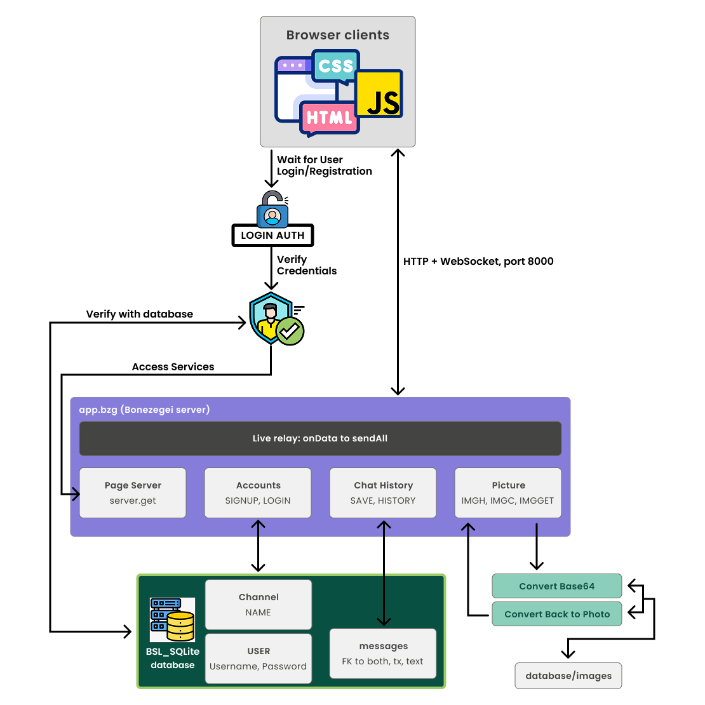

The diagram shows how the pieces fit together:

1. **Browser clients** (HTML, CSS and JavaScript) talk to the server over HTTP and WebSocket on port 8000.
2. A user must first log in or register. **Login Auth** verifies the credentials against the **BSL_SQLite database**.
3. Once verified, the user can access the services inside `app.bzg` (the Bonezegei server):
   - **Live relay**: `onData` to `sendAll` broadcasts chat packets to everyone.
   - **Page Server**: `server.get` serves the login page, chat page and assets.
   - **Accounts**: `SIGNUP` and `LOGIN` packets, backed by the user table (username, password).
   - **Chat History**: `SAVE` and `HISTORY` packets, backed by the messages table (foreign keys to both user and channel, timestamp, text) and the channel table.
   - **Picture**: `IMGH`, `IMGC` and `IMGGET` packets. Pictures are converted to Base64 for transfer and converted back to a photo when requested.

### UI design (Figma)

The interface was designed in Figma before it was built. The screenshot below shows the design file, with frames for the schematic diagram, the login page, the register page, the general chat and the voice chat lounge.

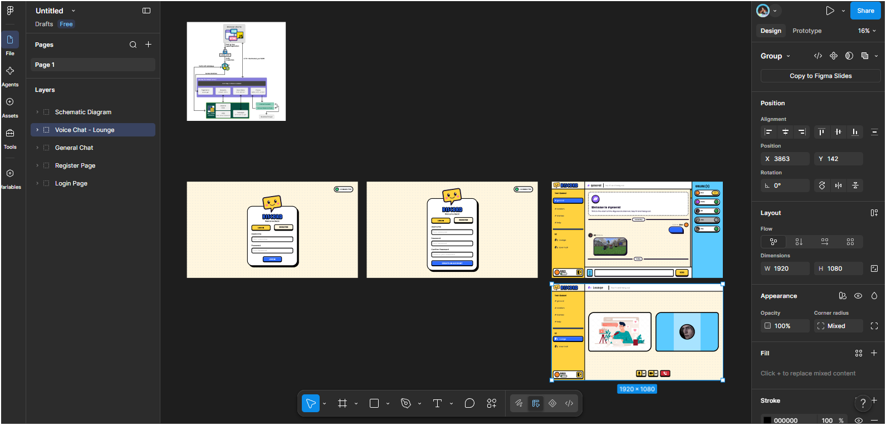


### Editing and deleting messages

Every message gets an id when it is sent, and the id is saved with the message in the database (`messages.mid`, plus an `edited` flag). Edit and delete use that id.

**Only the author can change a message.** The server checks two things on every `EDIT` and `DELETE` request, and refuses the request if either one fails:

1. **The request must carry the login secret.** When you log in or sign up, your browser sends a private random secret with the password. The server remembers it for that login and never broadcasts it. Tab ids are visible to everyone in live chat, so a tab id alone cannot be used to act as someone else.
2. **The message must belong to the logged-in user.** The server looks up who wrote the message in the database and compares it with the logged-in user. The `UPDATE` and `DELETE` statements repeat this author check in their `WHERE` clause.

The Edit and Delete buttons only appear on your own messages, but that is a convenience. Hiding the buttons is not what protects other people's messages. The server's checks above are.

The server also ignores fake `EDITED` / `DELETED` announcements sent by clients, and the browser ignores any such announcement that was relayed from another client.

**Notes**

- Pictures can be deleted but not edited. Deleting a picture also removes its saved data from the database.
- Messages saved before this feature existed get an id automatically the first time the new server starts (`old1`, `old2`, ...), so their authors can edit or delete them too. The two new columns are added to `chatterbox.db` automatically. Keep a copy of the database file first if you want a backup.
- If you were logged in when the server was updated, log out and back in so your login gets its secret.

### Profiles

Profile text is saved in the `profiles` table and pictures in `profile_images` (both are created automatically the first time the new `app.bzg` starts; existing data is untouched). Text fields travel URL-encoded; the browser shrinks the picture to 160x160 and the backdrop to 600x200 (JPEG) before sending them in small pieces, like chat pictures.

As with edit and delete, anyone logged in may **read** a profile, but every change packet must carry the login secret and the server only writes to the row of the logged-in user. Links are only shown if they are plain `http://` or `https://` addresses, and they open in a new tab.

### Account settings

The pop-up is in `public/chat.html` (`#acctModal`, and `#acctConfirm` for the "Accept these changes?" step), the logic in the "ACCOUNT SETTINGS" section at the end of `public/scripts/chat.js`, the look in the "ACCOUNT SETTINGS" part at the end of `public/style.css`, and the server side in the "ACCOUNT SETTINGS" part of `app.bzg`.

Nothing reaches the server until you press **Accept changes**. Then the browser sends `ACCTF|id||secret|cur|...`, `ACCTF|id||secret|name|...`, `ACCTF|id||secret|pw|...` (empty = unchanged) and `ACCTDO|id||secret`. The server checks, in this order:

1. the packet carries the login secret (same rule as edit, delete and profile changes),
2. the **current password** is right,
3. a new username is 2 to 16 characters, has no `|` or space at either end, and is not taken by somebody else (changing only the capital letters of your own name is fine),
4. a new password is 4 to 100 characters.

Then it updates only the logged-in user's row of `users`. Messages, pictures and the profile belong to the account (user id), so they follow the new name. Every login of that account is renamed on the server, and `NAMECHG||old|new` makes every browser rename the person in the member list, the messages and the typing dots. You stay logged in: the login secret does not change. The passwords are never printed in the server window or the console, and clients cannot fake `ACCTOK`, `ACCTERR` or `NAMECHG`.

### Project structure

```
.
├── app.bzg                 # The whole server (HTTP routes, WebSocket, accounts, history, pictures)
├── start-server.bat        # Windows launcher (checks setup, opens firewall, shows LAN URLs, auto-restarts)
├── package.json            # Project metadata and `npm start` script
├── lib/
│   ├── http.bzg            # Loads the http/socket native library (http/http.dll)
│   ├── http.json           # API description of the http/socket library
│   ├── sqlite.bzg          # Loads the SQLite native library (sqlite/sqlite.dll)
│   ├── http/http.dll
│   └── sqlite/sqlite.dll
├── docs/
│   ├── Schematic_Diagram.jpg   # Architecture diagram used in this README
│   ├── Figma_Design.png        # Screenshot of the Figma UI design file
│   └── *.png                   # Screenshots of the login, sign-up, chat, profile and 404 pages
├── public/                 # Files served to the browser
│   ├── login.html          # Login / sign-up page
│   ├── chat.html           # Chat page
│   ├── 404.html            # Page shown for unknown URLs
│   ├── style.css
│   └── scripts/
│       ├── common.js       # Shared WebSocket and packet helpers
│       ├── login.js
│       └── chat.js
└── database/
    ├── chatterbox.db       # SQLite database (users, channels, messages, pictures)
    └── images/
```

---

## 2. Installation & Setup Guide

### Requirements

- **Windows** (the bundled libraries are `.dll` files and the launcher is a `.bat` file)
- The **BSL interpreter** (`bonezegei` command)
- The **Socket (HTTP/WebSocket) library** and the **SQLite library**, both bundled in `lib/`
- A modern web browser

### Step 1: Install BSL

1. Obtain the BSL (Bonezegei) interpreter package from your course or instructor materials.
2. Install it and add it to your system **PATH**.
3. Open a new Command Prompt and check that the command is found:

   ```bat
   where bonezegei
   ```

   If it prints a path, BSL is installed correctly. If it says it could not find `bonezegei`, the interpreter is not on your PATH yet.

### Step 2: Get the project

Download or clone the repository, then open a terminal inside the project folder (the one containing `app.bzg`).

```bat
cd path\to\BISCORD
```

### Step 3: Install the socket library (and SQLite)

Both libraries are already included in `lib/`, so there is nothing to download. They are loaded by the server's first lines:

```js
include("lib/http.bzg");     // socket / HTTP + WebSocket library
include("lib/sqlite.bzg");   // SQLite library
var server = http(8000);     // start listening on port 8000
```

Each `.bzg` file loads its native DLL:

| File | Loads |
| --- | --- |
| `lib/http.bzg` | `http/http.dll` (Socket library v1.0.1: GET/POST routes and WebSocket send/receive) |
| `lib/sqlite.bzg` | `sqlite/sqlite.dll` (SQLite database access) |

Make sure the `lib/` folder keeps its structure (`lib/http/http.dll` and `lib/sqlite/sqlite.dll`), because the `.bzg` files refer to these relative paths.

> The `database/` folder must exist next to `app.bzg`. It already contains `chatterbox.db`; the tables are created automatically on startup if they are missing. Uploaded pictures are stored inside the database.

### Step 4: Run the server

**Option A: Windows launcher (recommended)**

Double-click `start-server.bat`, or run it from the terminal:

```bat
start-server.bat
```

The launcher will:

1. Check that `bonezegei` and `app.bzg` are found.
2. Create `database\images` if needed.
3. Check for a Windows Firewall rule for port 8000.
4. Print the addresses other devices can open, for example `http://192.168.1.20:8000`.
5. Start the server and restart it automatically if it ever exits.

> **First run, for LAN access:** right-click `start-server.bat` → **Run as administrator** once. This adds the firewall rule (`BISCORD LAN TCP 8000`) so phones and other laptops can connect. After that you can run it normally.

**Option B: Run the script directly**

```bat
bonezegei app.bzg
```

or, if you have npm available:

```bat
npm start
```

When the server starts correctly, the console prints something like:

```
Database ready: database/chatterbox.db (N user(s), N message(s))
```

If you see `ERROR: database ... is not working`, check that the `database` folder exists.

Keep the console window open while people are chatting. Press **Ctrl+C** to stop the server.

---

## 3. Usage Instructions

Replace `localhost` with the server's LAN IP (for example `192.168.1.20`) when opening the app from another device on the same Wi-Fi.

### Page endpoints

| URL | What you get |
| --- | --- |
| `http://localhost:8000/` | Login / sign-up page |
| `http://localhost:8000/login` | Same login / sign-up page |
| `http://localhost:8000/login.html` | Same login / sign-up page |
| `http://localhost:8000/chat` | Chat page (redirects to the login page if you are not logged in) |
| `http://localhost:8000/chat.html` | Same chat page |
| `http://localhost:8000/anything-else` | 404 page ("404 - Page Not Found") |

### Static asset endpoints

These are loaded automatically by the pages, but you can open them in the browser to check they are being served:

| URL | File |
| --- | --- |
| `http://localhost:8000/style.css` | Stylesheet |
| `http://localhost:8000/scripts/common.js` | Shared WebSocket helpers |
| `http://localhost:8000/scripts/login.js` | Login page script |
| `http://localhost:8000/scripts/chat.js` | Chat page script |

### WebSocket endpoint

The chat page connects to `ws://<host>:8000`. Accounts, history, pictures and live chat all travel over this one connection, so no other ports or REST endpoints are required.

### Walkthrough

1. **Open the app** at `http://localhost:8000/`.
2. **Sign up**: choose a username (2–16 characters) and a password, then submit. Next time, use **Log in**.
3. **Chat**: you land on `#general`. Pick another channel (`#random`, `#help`, `#memes`) from the left sidebar.
4. **Send a message**: type in the box at the bottom and press **Enter** or click **Send** (max 300 characters). Press **Ctrl+Enter** (Cmd+Enter on a Mac) to start a new line; the box grows as you type and the message keeps its line breaks.
5. **Edit or delete a message**: hover over one of your own messages and click the pencil to edit it (Enter saves, Ctrl+Enter adds a line, Esc cancels) or the bin to delete it (you are asked to confirm). Both changes appear instantly for everyone in the channel. Other people's messages have no buttons.
6. **Send a picture**: click the attach button, or drag and drop an image onto the chat. Pictures are resized and compressed automatically.
7. **See who is around**: the members panel on the right shows online users and the total number of registered accounts. A "typing" indicator appears when someone is writing.
8. **Debug**: expand the connection console at the bottom to watch packets going back and forth.
9. **Log out** with the log-out button in the sidebar.

To test live chat, open the app in two different browsers (or one normal and one private window) and log in with two different accounts.

### Troubleshooting

| Problem | Fix |
| --- | --- |
| `"bonezegei" was not found on this PC` | Install BSL and add it to PATH, then open a new terminal. |
| Other devices cannot connect | Run `start-server.bat` as administrator once, and make sure all devices are on the same Wi-Fi. |
| Blank chat or "session ended" message | Make sure the server is running the latest `app.bzg`, then log in again. |
| `ERROR: database ... is not working` | Confirm the `database/` folder exists next to `app.bzg`. |
| "Couldn't edit/delete that message" | Read the reason shown in the chat. If it says to log out and back in, do that. You can only change your own messages. |
| Port 8000 already in use | Close the other program using it, or change the `http(8000)` value in `app.bzg` (and `PORT` in `start-server.bat`). |

---

### Screenshots

Screenshots of the finished app. The **connection console** is the purple `>_` button at the bottom of each page; it expands into a live log of the packets going between the browser and the server.

#### Login page

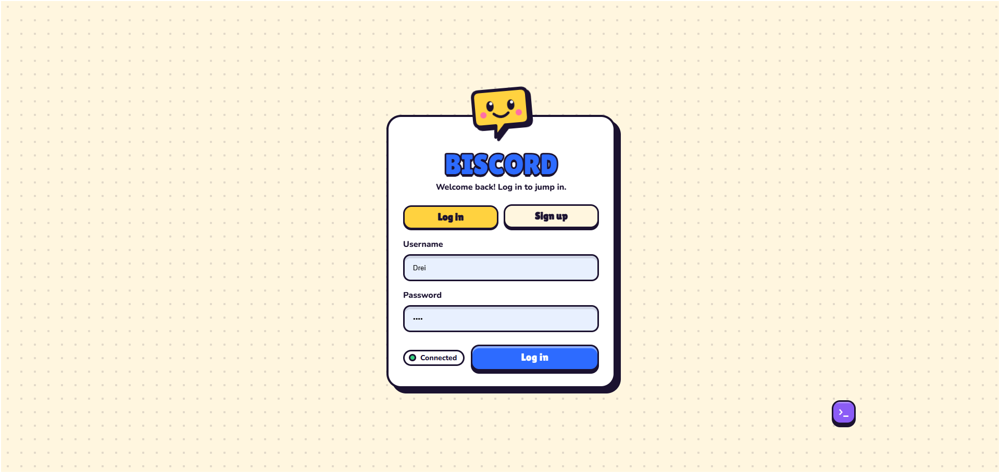

The login page (`login.html`) with the **Log in** tab selected. The status pill next to the button shows **Connected** once the WebSocket handshake with the server is complete. The collapsed console is the small purple button at the bottom right.

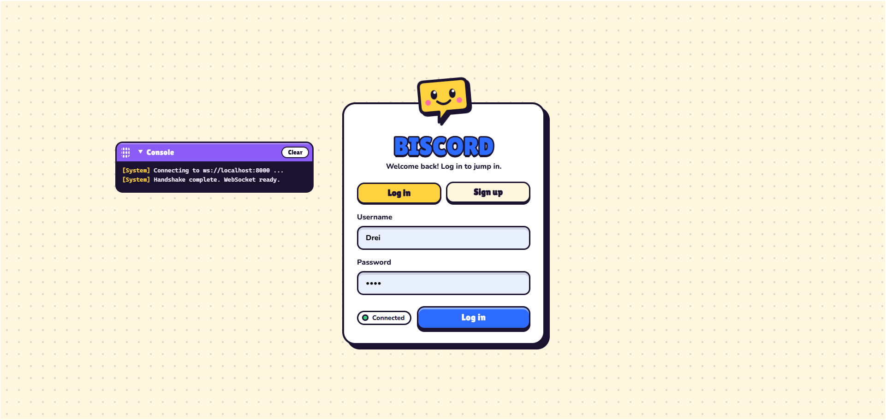

The same page with the console expanded. It logs the connection steps (`Connecting to ws://localhost:8000 ...` and `Handshake complete. WebSocket ready.`), tagged `[System]`, and can be cleared with the **Clear** button. The console can be dragged to another spot on the screen.

#### Sign-up page

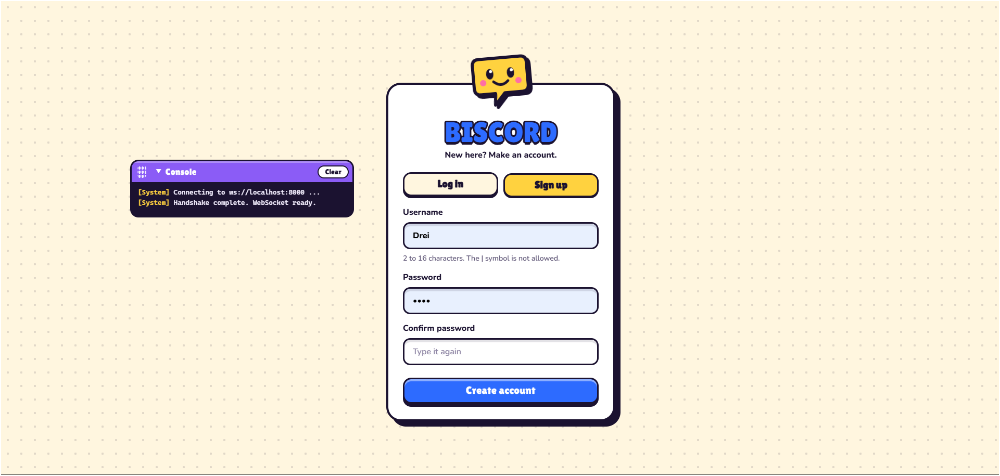

The **Sign up** tab, where a new user picks a username (2 to 16 characters, the `|` symbol is not allowed) and a password, then types the password again to confirm it. **Create account** registers the user.

#### Chat page

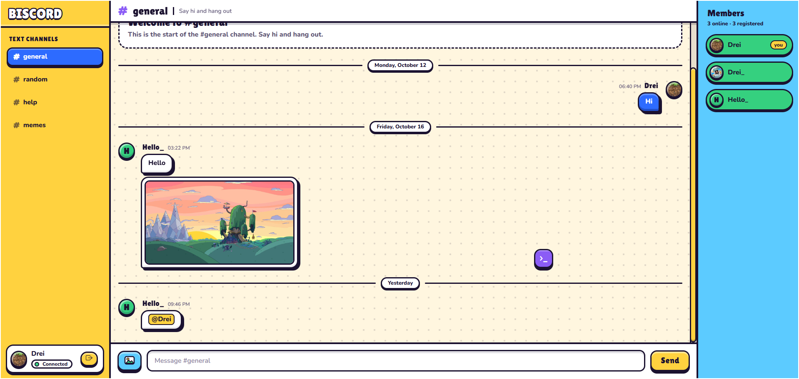

The main chat page, laid out like Discord. The left sidebar lists the channels (`#general`, `#random`, `#help`, `#memes`) and your user card with the connection status and the log-out button. The middle shows the messages of the current channel: your own messages are blue bubbles on the right, other people's are white bubbles on the left, and a picture can be sent with the image button. An `@mention` is highlighted. The right panel lists the members, with the online ones in green and a `you` tag on your own entry. The message box is at the bottom.

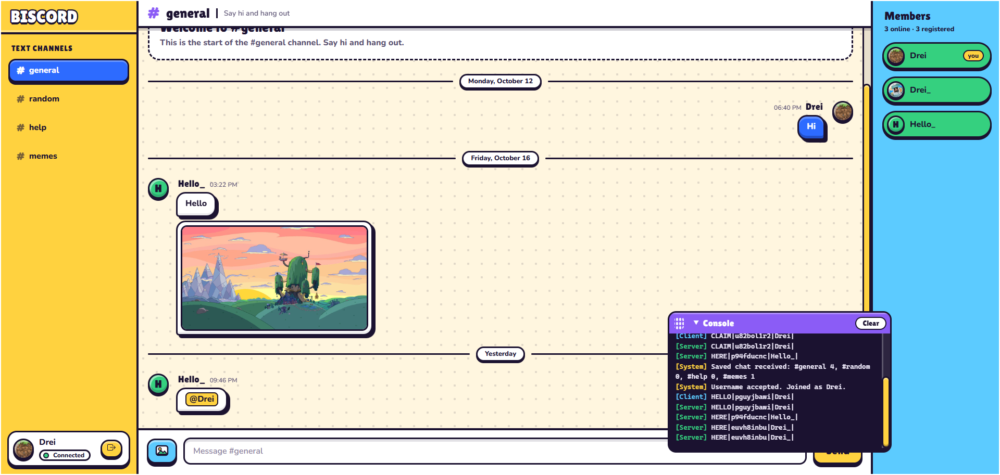

The chat page with the console open, showing the raw packets as they travel (`[Client]` for packets the browser sends, `[Server]` for packets the server sends back, `[System]` for notices such as `Username accepted. Joined as Drei.`). This is handy for debugging.

#### Profile card

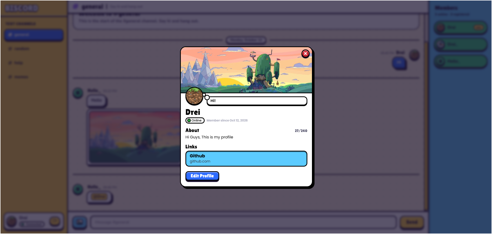

A profile card, opened by clicking your own user card or a member in the panel. It shows the backdrop picture, profile picture, thought bubble, username, online status, the date the user joined, the **About** text (with a character counter) and up to three links. On your own profile there is also an **Edit Profile** button.

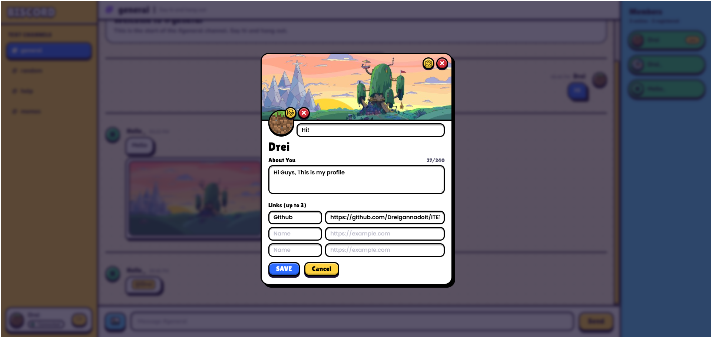

The edit view of your own profile. You can change the backdrop picture and the profile picture (or remove them with the red buttons), write a thought bubble and an **About You** text (up to 240 characters), and add up to three links, each with a name and a URL. **SAVE** applies the changes for everyone, and **Cancel** goes back without saving.

#### 404 page

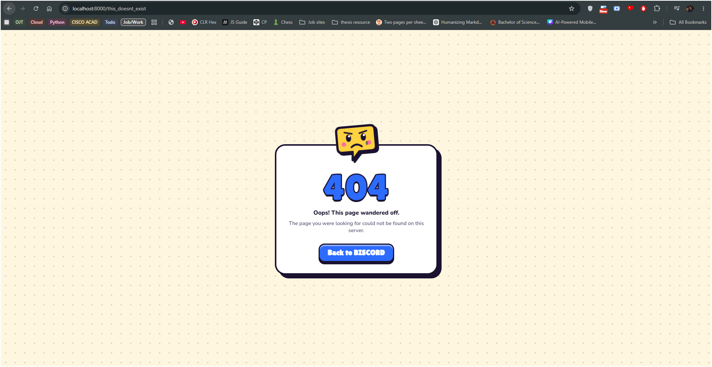

The page shown for any unknown URL, for example `http://localhost:8000/this_doesnt_exist`. It matches the look of the rest of the app and has a **Back to BISCORD** button that returns to the login page.

---

## Expected Terminal Output

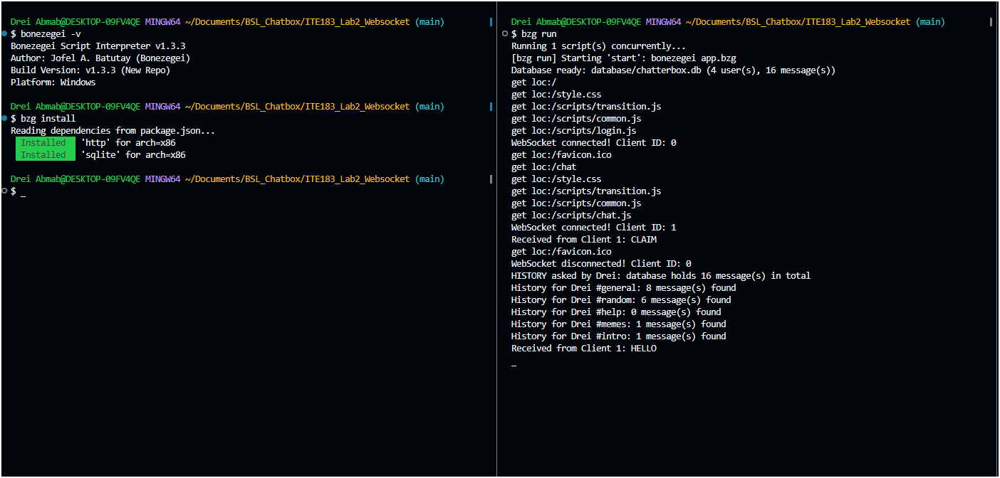

---

## Notes & Limitations

- This is a personal / learning project: **passwords are stored as plain text** and there is no real security. Do not reuse a real password.
- Edited messages keep their original time and show "(edited)". There is no edit history.
- Messages are limited to 1000 characters; pictures are compressed to roughly 530 KB before sending.
- The channel list is defined in `app.bzg` (`CHANNELS`) and must be kept in sync with the client.

## License

MIT